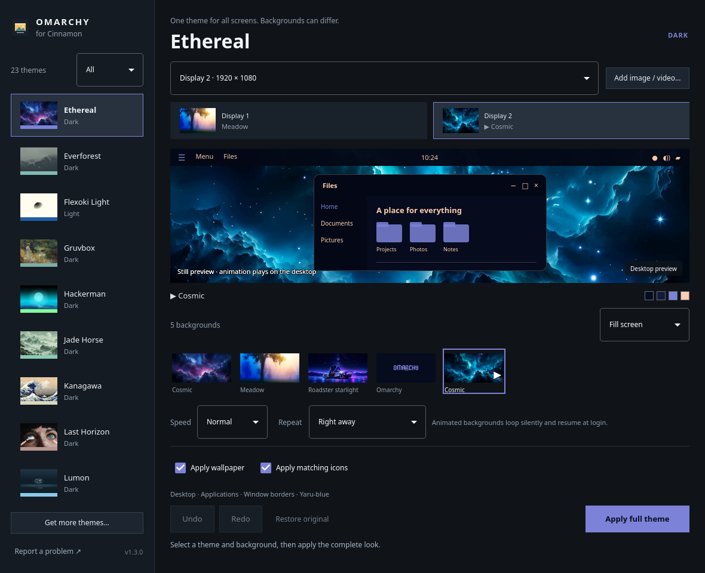

# Cinnarchy — Omarchy Theme Picker for Cinnamon



Bring [Omarchy](https://omarchy.org)'s themes to the Cinnamon desktop.
Select a complete Omarchy look, choose its wallpaper, and click **Apply full
theme**. The picker switches Cinnamon desktop styling, GTK applications,
window borders, matching icons, background and the dark/light preference
together. It includes all 23 palettes from Omarchy 4.5.0. You don't need
Omarchy installed: the picker downloads Omarchy's own backgrounds on request,
and **Get more themes…** adds new official themes and hundreds of community
themes.

Cinnarchy is an independent project, not affiliated with or endorsed by
Omarchy, Basecamp or Linux Mint.

## Install

Cinnarchy is for the **Cinnamon** desktop, in its regular (X11) session. That
is what Linux Mint and LMDE start by default. Cinnamon's experimental Wayland
session is not supported. The picker needs a screen of 1024×768 or larger.

**1. Download the installer for your system.**

| Your system | Installer |
| --- | --- |
| Linux Mint 22, 22.1, 22.2 or 22.3 (Cinnamon edition) | [**Download for Linux Mint 22**](https://github.com/CyberJody/cinnarchy/releases/latest/download/cinnarchy-linux-mint-22.deb) |
| LMDE 7, or Debian 13 with Cinnamon | [**Download for LMDE 7**](https://github.com/CyberJody/cinnarchy/releases/latest/download/cinnarchy-lmde-7-debian-13.deb) |

Not sure which you have? Open the menu, type **System Info** and look at the
first line.

The second installer is built and tested on Debian 13. LMDE 7 is based on
Debian 13, so it should work there too, but it has **not been tested on LMDE
itself** yet. If you try it on LMDE, please
[report how it went](https://github.com/CyberJody/cinnarchy/issues).

**2. Open the downloaded file.** It is in your Downloads folder; double-click
it and the package installer opens.

**3. Click Install Package** and type your password when asked. The installer
may list a few extra packages it needs; that is expected.

**4. Open the menu and start Omarchy Theme Picker.** Pick a theme and click
**Apply full theme**. **Restore original** brings back the look you had before.

To update, download and install the newest installer the same way. Your theme
and backgrounds stay as they are.

**If the installer says "Failed to download package files":** your Internet
connection is most likely fine. On a new Linux Mint installation the list of
available software is out of date until Update Manager has refreshed it once.
Open **Update Manager** from the menu, click **OK** on its welcome screen,
click **Refresh**, and then open the Cinnarchy installer again.

### Remove

Right-click **Omarchy Theme Picker** in the menu and choose **Uninstall**, or
run `sudo apt remove cinnarchy`.
Removing Cinnarchy puts your desktop back the way it was before you first
applied a theme: theme, icons and background return, animated backgrounds stop
and nothing is left to start at login. If Cinnarchy has no record of your
earlier setup, you get your system's default look instead.

This happens for whoever is logged in when Cinnarchy is removed. On a computer
with several accounts, the others should click **Restore original** first.
If you installed Cinnarchy another way than with these installers, run
`cinnarchy reset` before removing it.

Themes and backgrounds you downloaded are kept, as your own files. To delete
them too, remove `~/.config/omarchy/themes`, `~/.local/state/cinnarchy` and
the `Omarchy-…` folders in `~/.themes`.

The Linux Mint 22 installer also works on Ubuntu 24.04 with Cinnamon. Linux
Mint 21 and older are not supported. From a terminal, the same install is
`sudo apt install ./cinnarchy-*.deb`. Every version is on the
[releases page](https://github.com/CyberJody/cinnarchy/releases); on other
systems, [build it from source](#build-from-source).

## Multiple displays and animation

Choose a connector in the display selector, then select a background. Repeat
for each monitor and click **Apply full theme** once. Each screen keeps its own
image and sizing; the Cinnamon/GTK theme applies across the desktop.
**All displays · same background** assigns the next chosen background to every
screen. **Span screens** stretches one shared scene across the desktop layout.

Use **Add image / video…** to import your own files through the desktop file
chooser. GIF, animated WebP, MP4, WebM and other mpv-decodable videos loop
silently. Bundled Omarchy video intros appear beside the still images, marked
with a play symbol. Videos and images can be mixed across monitors. When Qt uses its software
renderer, video previews show a labeled still poster; desktop animation
continues to use the separate player.

With a video, GIF or animated WebP selected, **Speed** (0.25× to 2×) and
**Repeat** appear under the thumbnails. Repeat sets how long the animation
rests on its last frame before playing again: right away, after 5 seconds up to
an hour, or never, which plays it once at login and leaves it still. Each
display keeps its own choices. A background that is already playing follows a
change at once; otherwise it takes effect with **Apply full theme**.

Live wallpapers require an X11 Cinnamon session. The player sits behind
desktop icons, ignores clicks, and continues when the picker closes.
**Pause animation** freezes playback; **Stop animation** leaves static poster
images. Display assignments and live playback resume at login through a
managed `~/.config/autostart/cinnarchy-wallpaper.desktop` entry. Choosing a
wallpaper in Cinnamon’s regular Backgrounds tool stops the live player and
returns control to Cinnamon. Undo/Redo/Restore include wallpaper assignments.
Changing monitor layout rebuilds the combined background for connected screens.
To keep desktop icons visible over the video, the player adds its window class
(`CinnarchyWallpaper`) to Nemo's `org.nemo.desktop ignored-desktop-handlers`
setting.

## Desktop transparency repair

All bundled GTK themes keep Nemo desktop windows, views and notebook stacks
transparent in both normal and inactive states. This fixes the solid-color
layer that hid wallpapers on the monitor hosting desktop icons, including
wallpaper changes made through Cinnamon's regular Backgrounds tool.

Older generated theme folders are upgraded with a full backup when applied.
When an active theme is upgraded, existing GTK windows are refreshed so Nemo
picks up the repaired stylesheet immediately.

## Use

Open **Omarchy Theme Picker** from the Cinnamon menu, or run `cinnarchy open`.
Filter the theme list by Dark or Light, select a background thumbnail and choose its
sizing. **Apply wallpaper** and **Apply matching icons** are on by default.
Their checkboxes let you retain those parts of your current setup.

The desktop preview illustrates the selected Cinnamon/GTK colors over the
actual wallpaper. Available source icon packs are shown below the preview.
When a requested pack is unavailable, an installed Papirus or Adwaita fallback
is named explicitly. Background images stay in their existing folders.
A background file that has gone missing is reported before anything changes.

A theme with no backgrounds installed keeps the background you already have.
For a built-in theme the picker offers **Download backgrounds** in place of the
thumbnails: it fetches that theme's official backgrounds from Omarchy's
repository (1–25 MB), and **Download for all themes** fetches every one
(about 170 MB). They are saved under `~/.config/omarchy/themes/`.

User backgrounds in `~/.config/omarchy/backgrounds/<slug>/` and user theme
backgrounds in `~/.config/omarchy/themes/<slug>/backgrounds/` are discovered
alongside stock images. Refresh with Ctrl+R after adding files.
Themes added with **Get more themes…** are discovered via their
`~/.themes/Omarchy-<slug>/palette.json` files.

## Get more themes

Omarchy's official themes live in the `themes/` folder of
[github.com/omacom/omarchy](https://github.com/omacom/omarchy) (formerly
basecamp/omarchy). Click **Get more themes…** and then **Check for new themes**
to download any official theme added since this release. Only the new theme
folders are downloaded. The same dialog lists the community themes from
[omarchy.org/themes](https://omarchy.org/themes/) with their screenshots; click
**Install** on one, or paste any theme's git URL. Installing again updates it.

Downloaded themes go to `~/.config/omarchy/themes/<name>/`, where Omarchy
keeps user themes. A `.cinnarchy-source` file records where each one came from.
Their backgrounds and icon choice are used like the stock ones. The picker then
builds the matching Cinnamon/GTK theme in `~/.themes/Omarchy-<name>/` from the
theme's `colors.toml`, or from `alacritty.toml` for older themes, using the
same missing-color fallbacks as Omarchy. Themes you installed by other means
also get a Cinnamon theme. Folders the picker did not create are never
replaced. Repositories are cloned without prompts or symbolic links, and URLs
naming git options or transport helpers are refused. Fetching requires `git`.

The generated themes come from the same template as the bundled ones.
`bin/make-theme-template` rebuilds `data/template/` from the bundled themes and
checks that it reproduces all of them byte for byte.

GTK 4/libadwaita applications receive Cinnamon's light/dark and accent preferences; full
libadwaita widget recoloring is outside the bundled GTK theme. Fonts and cursor
settings have no per-palette values and are preserved.

## Build from source

Requirements: Qt 6 base, declarative/Quick Controls, SVG and Multimedia;
GLib/GIO; X11, XRandR and Xext; Cinnamon; mpv, ffmpeg, git and XDG desktop portal;
a C++17 compiler, qmake6 and make. Cinnamon/GTK theme assets and each built-in
theme's icon choice are embedded in the binary; themes are installed into
`~/.themes` on demand. Wallpapers come from an installed Omarchy, from the
`omarchy-theme-backgrounds` package below, or from **Download backgrounds** in
the picker (`cinnarchy fetch --backgrounds` on the command line).

Developed and tested in X11 sessions on two systems: Cinnamon 6.6 with Qt 6.12,
and Debian 13 with Cinnamon 6.4 and Qt 6.8. The Debian steps below should also
apply to LMDE 7, which shares Debian 13's packages, but LMDE itself is untested.

```sh
git clone https://github.com/CyberJody/cinnarchy.git
cd cinnarchy
./bin/build
./bin/test
python3 tests/gtk_desktop_regression.py
./bin/install-user
```

The user installer places the binary in `~/.local/bin/cinnarchy`, with a
Cinnamon menu entry and icon under your user data directory. It does not
require administrator access. For an Arch package, `./bin/package` creates
`pkgbuild/cinnarchy-1.3.2-1-x86_64.pkg.tar.zst`; `./bin/install` builds and
installs it through makepkg/pacman.

### Debian 13 (trixie)

Install the build and runtime packages, build, then create and install the
`.deb` files:

```sh
sudo apt install qmake6 qt6-base-dev qt6-declarative-dev qt6-multimedia-dev \
  qt6-svg-dev qt6-svg-plugins qt6-qpa-plugins qt6-image-formats-plugins \
  qml6-module-qtquick-controls qml6-module-qtquick-layouts qml6-module-qtmultimedia \
  libglib2.0-dev libx11-dev libxrandr-dev libxext-dev pkgconf \
  mpv ffmpeg git yaru-theme-icon papirus-icon-theme
./bin/package-deb
sudo apt install ./pkgdeb/*.deb
```

Debian has no Omarchy, so `bin/package-deb` also builds the optional
`omarchy-theme-backgrounds`. It has the `backgrounds/` and `icons.theme` files
from Omarchy v4.5.0 (git tag) and the checksum-verified
`omarchy-themes-intros` videos, installed in Omarchy's own layout under
`/usr/share/omarchy/themes`. `qt6-image-formats-plugins` is needed for the
WebP wallpapers. Debian's Yaru 24.04 lacks some newer accents; wartybrown
maps to `Yaru-bark`, yellow to `Yaru`, and gray/grey fall back to Papirus.

State and recovery snapshots are saved atomically under
`~/.local/state/cinnarchy/` (or `$XDG_STATE_HOME/cinnarchy/`). No packaged
Omarchy files are modified. Missing built-in theme files are installed from
the embedded assets. Incomplete generated theme folders are backed up before
repair; unrelated folders and symbolic links are not replaced.

## Keyboard

| Shortcut | Action |
| --- | --- |
| Ctrl+Enter | Apply the full theme |
| Space | Apply the full theme, or press the button or checkbox that has keyboard focus |
| Ctrl+Z | Undo |
| Ctrl+Shift+Z | Redo |
| Ctrl+R | Refresh themes and backgrounds |
| Q | Close picker |

Shortcuts are inactive while the Get more themes dialog is open.
The app follows Omarchy's language setting without changing it; English and
Danish catalogs are included, with English fallback for other languages.

## Command line and agent use

```sh
cinnarchy list --json
cinnarchy status --json
cinnarchy check --json
cinnarchy apply tokyo-night --background 2 --json
cinnarchy apply ethereal --display HDMI-A-0 --background 3 --json
cinnarchy apply ethereal --file /path/to/animated.webp --json
cinnarchy fetch --json              # new official themes from GitHub
cinnarchy fetch --url https://github.com/user/omarchy-name-theme --json
cinnarchy fetch --community --json  # community themes listed on omarchy.org
cinnarchy fetch --backgrounds --json  # Omarchy's backgrounds for built-in themes lacking them
cinnarchy apply ethereal --screen-background DP-1=/path/to/photo.jpg \
  --screen-background HDMI-1=/path/to/video.mp4 --json
cinnarchy apply ethereal --background 5 --speed 0.5 --repeat-after 30 --json
cinnarchy pause --json              # toggle playback
cinnarchy stop-animation --json
cinnarchy undo --json
cinnarchy redo --json
cinnarchy restore --json
cinnarchy reset --json              # as restore, or the system defaults; run on removal
cinnarchy skill install
```

Background numbers start at 1, in the order returned by `list`. Apply also
accepts `--no-wallpaper`, `--no-icons` and `--fit zoom|scaled|spanned|centered`.
For animated backgrounds, `--speed` takes 0.25 to 4 and `--repeat-after` the
seconds to rest between loops, `0` to loop at once or `once` to play a single
time.
Connector IDs are returned by `status`; paths are local and originals are
left in place. Span sizing requires the all-displays target.
Commands return nonzero on failure. The optional agent skill is embedded and
can be installed into your Codex skill directory with the last command.

`cinnarchy screenshot --select tokyo-night --output preview.png` renders the
actual QML offscreen without changing desktop settings. `--language da` previews
Danish without changing the system language. `--state-dir` and `--theme-root`
provide isolated locations for development tests.

Sources and attribution: bundled palette data from
[Omarchy](https://github.com/omacom/omarchy); Cinnamon themes derived from
[Cinnamon's default theme](https://github.com/linuxmint/cinnamon/tree/master/data/theme);
Theme/Translator templates adapted from Omacut and Monologue (David Heinemeier
Hansson, MIT). See [LICENSE](LICENSE) and [NOTICE](NOTICE).

## Report a problem

Click **Report a problem** at the bottom of the picker's sidebar. It opens a
new [GitHub issue](https://github.com/CyberJody/cinnarchy/issues) with your
Cinnarchy version, distribution, Cinnamon and Qt versions, session type and
active theme filled in; nothing is sent until you submit it. You can also open
an issue directly. Ideas are welcome too.

## Contributing

Pull requests are welcome. Run `./bin/test` and
`python3 tests/gtk_desktop_regression.py` before sending one. If you change a
bundled theme's styling, run `bin/make-theme-template` so downloaded themes get
the same change; it fails unless the template reproduces every bundled theme.
See [CHANGELOG.md](CHANGELOG.md) for what changed in each release.

## License

Cinnarchy is free software under the
[GNU General Public License, version 2 or later](LICENSE): you may use, study,
share and change it, and versions you pass on must stay under the same license
with their source available. It comes with no warranty.

It includes material from Cinnamon (GPL version 2 or later) and Omarchy (MIT).
[NOTICE](NOTICE) lists what comes from where. No wallpapers are included;
downloaded backgrounds remain the work of their artists.
